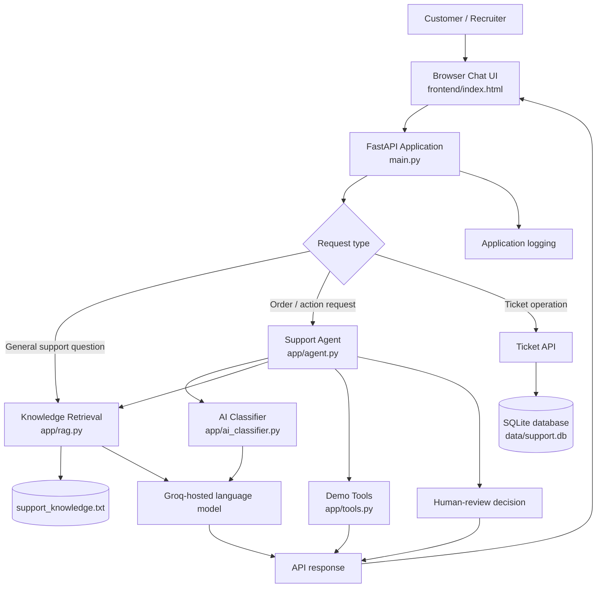

# AI Customer Support Automation Agent

An AI-assisted customer support prototype built with **FastAPI, Groq, retrieval-augmented generation (RAG), and a lightweight HTML/CSS/JavaScript chat interface**. It demonstrates how incoming support requests can be classified, answered from a knowledge base, routed to tools, and flagged for human review when an action needs approval.

> **Project status:** Portfolio/demo project. Order records are simulated. This is not a production customer-support system and should not be connected to real customer data without authentication, authorization, privacy controls, and production-grade persistence.


## Contents

- [Overview](#overview)
- [Key features](#key-features)
- [Architecture](#architecture)
- [Request workflow](#request-workflow)
- [Technology stack](#technology-stack)
- [Repository structure](#repository-structure)
- [Requirements](#requirements)
- [Local setup](#local-setup)
- [Configuration and secrets](#configuration-and-secrets)
- [Run the application](#run-the-application)
- [API reference](#api-reference)
- [Try the demo](#try-the-demo)
- [Testing](#testing)
- [Deployment](#deployment)
- [Limitations and security notes](#limitations-and-security-notes)
- [Roadmap](#roadmap)

## Overview

Customer-support teams receive a mix of order-status questions, delivery complaints, refund requests, cancellation requests, and general product questions. Handling every request manually can be repetitive, while fully automated actions can be risky.

This project explores a **human-in-the-loop** approach:

1. Accept a support message.
2. Classify the request and identify relevant context.
3. Retrieve potentially relevant information from a local support knowledge base.
4. Use an LLM to help formulate a grounded response.
5. Call a narrowly scoped demo tool when the request needs order information.
6. Flag sensitive or consequential requests for review rather than treating the model's response as approval.

The repository includes a small browser-based chat interface and a REST API that can also be explored independently through FastAPI's interactive documentation.

## Key features

- **Ticket classification:** identifies request intent, sentiment, and priority through the AI classification module.
- **Knowledge-base question answering:** retrieves relevant passages from `data/support_knowledge.txt` and uses them as context for responses.
- **Order lookup tool:** looks up a small set of simulated orders for demonstration.
- **Agent endpoint:** combines classification, retrieval, and available tools into a support workflow.
- **Human-review flow:** supports review-oriented handling for requests that should not be automatically approved.
- **Ticket API:** creates and retrieves ticket records.
- **Browser chat UI:** a lightweight frontend that communicates with the API.
- **Health endpoint:** provides a simple service-health check.
- **Automated tests:** tests are located in `tests/`.

## Architecture



### Main components

| Component | Responsibility |
|---|---|
| `frontend/index.html` | Chat interface and browser-side request routing |
| `main.py` | FastAPI application, HTTP endpoints, request validation, and middleware |
| `app/ai_classifier.py` | Classifies support messages |
| `app/rag.py` | Retrieves relevant knowledge-base content and generates a contextual answer |
| `app/agent.py` | Coordinates classification, retrieval, tool use, and review decisions |
| `app/tools.py` | Contains demo tools and simulated order records |
| `app/database.py` | SQLite persistence and database operations |
| `app/logging_config.py` | Application logging configuration |
| `data/support_knowledge.txt` | Text knowledge base used for support answers |
| `tests/` | Automated tests |

## Request workflow

### 1. General question

A message such as “What is your refund policy?” can be sent to the question-answering endpoint. The RAG module searches the support knowledge base for relevant text and uses that context to prepare a response. Retrieved sources may be returned with the answer.

### 2. Order-related request

A message such as “Where is order ORD-1001?” can be routed through the agent workflow. The agent can use the order-lookup tool to retrieve the corresponding **simulated** order information. The demo data is not connected to a real commerce platform.

### 3. Sensitive or consequential request

Requests involving refunds, cancellations, or other actions that need extra care can be flagged for review. A generated answer is not equivalent to approval, and the prototype should not execute real-world financial or account actions without explicit authorization and a secure approval process.

### 4. Ticket creation and review

The ticket endpoints expose ticket operations through the API. Review-related endpoints support the project's human-review workflow. Consult `/docs` in a running instance for the exact request schemas and response models.

## Technology stack

- **Backend:** Python, FastAPI, Pydantic, Uvicorn
- **LLM provider:** Groq API; configured model in the current project: `openai/gpt-oss-20b`
- **Retrieval:** Sentence Transformers (`sentence-transformers/all-MiniLM-L6-v2`) and cosine-similarity ranking
- **Data storage:** SQLite
- **Frontend:** HTML, CSS, and vanilla JavaScript
- **Testing:** pytest
- **Configuration:** environment variables loaded from a local `.env` file

The exact installed package versions are defined in `requirements.txt`.

## Repository structure

```text
customer-support-agent/
├── app/
│   ├── agent.py
│   ├── ai_classifier.py
│   ├── database.py
│   ├── logging_config.py
│   ├── rag.py
│   └── tools.py
├── data/
│   └── support_knowledge.txt
├── frontend/
│   └── index.html
├── tests/
├── .dockerignore
├── .env.example
├── .gitignore
├── Dockerfile
├── main.py
├── requirements.txt
└── README.md
```

Generated files such as the local SQLite database may appear at runtime and are intentionally not part of the repository.

## Requirements

- Python 3.12 is the recommended version for the current development setup.
- A Groq API key for model-backed features.
- Git, if cloning the repository.
- Internet access during initial dependency/model downloads.

## Local setup

### 1. Clone the repository

Replace the placeholder with the URL of your GitHub repository:

```bash
git clone <YOUR_GITHUB_REPOSITORY_URL>
cd customer-support-agent
```

If you already have the project locally, open a terminal in the project root instead.

### 2. Create and activate a virtual environment

**Windows PowerShell**

```powershell
py -3.12 -m venv .venv
.\.venv\Scripts\Activate.ps1
```

If PowerShell blocks activation, you can either adjust your local execution policy appropriately or use the virtual environment's interpreter directly:

```powershell
.\.venv\Scripts\python.exe -m pip install -r requirements.txt
```

**macOS / Linux**

```bash
python3.12 -m venv .venv
source .venv/bin/activate
```

### 3. Install dependencies

```bash
python -m pip install --upgrade pip
pip install -r requirements.txt
```

### 4. Configure environment variables

Copy `.env.example` to `.env` and add your own Groq API key.

**Windows PowerShell**

```powershell
Copy-Item .env.example .env
```

Then open `.env` in your editor and set the value:

```dotenv
GROQ_API_KEY=your_groq_api_key_here
```

Use the variable names shown in your actual `.env.example` if the project requires additional settings. Never commit `.env` or paste API keys into source code, README files, screenshots, or issue reports.

### 5. Start the API

From the project root:

```powershell
uvicorn main:app --reload
```

The API should be available at `http://127.0.0.1:8000` when startup completes successfully.

## Run the application

| Resource | Local URL | Purpose |
|---|---|---|
| API root | `http://127.0.0.1:8000/` | Basic application response |
| Health check | `http://127.0.0.1:8000/health` | Service health status |
| Interactive API docs | `http://127.0.0.1:8000/docs` | Explore endpoints and send test requests |
| Alternative API docs | `http://127.0.0.1:8000/redoc` | Read-only API reference |
| Frontend | Open `frontend/index.html` using a local static server | Browser chat interface |

For the frontend, the current browser code is configured to use a local API base URL. If you serve the frontend locally, make sure its configured API URL and the backend's CORS allowlist match your local setup. For example, if you use port `5500`, the frontend origin is usually `http://127.0.0.1:5500` or `http://localhost:5500`.

## Configuration and secrets

- `.env.example` documents the environment-variable names needed by the project.
- `.env` holds local secret values and must remain untracked.
- On a hosting platform, configure `GROQ_API_KEY` in the service's environment-variable settings.
- Do not expose provider API keys in frontend JavaScript. Browser code is public to every visitor.
- If a key was ever committed or otherwise exposed, revoke it and create a replacement; deleting the line in a later commit is not sufficient.

## API reference

The following endpoints are present in the current application. Open `/docs` for the authoritative request schemas, parameters, and response formats.

| Method | Endpoint | Purpose |
|---|---|---|
| `GET` | `/` | Basic application response |
| `GET` | `/health` | Health check |
| `POST` | `/tickets/preview` | Preview/classify a ticket without creating a regular ticket record |
| `POST` | `/tickets` | Create a ticket |
| `GET` | `/tickets/{ticket_id}` | Retrieve a ticket |
| `POST` | `/ask` | Ask a support question using the knowledge-answering flow |
| `POST` | `/tools/order-lookup` | Call the simulated order lookup tool |
| `POST` | `/agent` | Run the support-agent workflow |
| `GET` or `POST` | `/tickets/review` | Review queue operation, depending on the route definition |
| `POST` | `/tickets/{ticket_id}/review` | Submit a review decision for a ticket |

> **Note:** FastAPI's `/docs` page is the source of truth for the exact methods and input/output schemas. If an endpoint's method differs in your current code, follow the live OpenAPI documentation rather than this summary.

## Try the demo

Start the backend, then open the frontend. Example prompts to try:

- “What is your delivery policy?”
- “What is your refund policy?”
- “Where is order ORD-1001?”
- “My order is late. Can you help?”
- “I want to cancel my order.”
- “I have a payment issue.”

The simulated order records currently include:

| Order ID | Demo customer ID | Status | Estimated delivery |
|---|---|---|---|
| `ORD-1001` | `CUST-1001` | Shipped | 2026-10-28 |
| `ORD-1002` | `CUST-1002` | Processing | 2026-10-30 |
| `ORD-1003` | `CUST-1003` | Delayed | 2026-10-25 |

These values are sample data for testing only. Dates are illustrative seed data and may be in the past or future depending on when the project is run.

## Testing

Run the automated test suite from the repository root:

```powershell
python -m pytest tests/ -v
```

A previous local run reported 10 passing tests. Re-run the suite against your current checkout before relying on that result; test outcomes can change as code changes.

For a quick manual check, start the API and visit `/health` and `/docs`.

## Deployment

The application can be hosted as two services:

1. **Backend web service:** deploy the FastAPI application from the repository root.
2. **Frontend static site:** deploy the `frontend/` directory as a static site.

For a Render deployment, the backend configuration is typically:

- **Build command:** `pip install -r requirements.txt`
- **Start command:** `uvicorn main:app --host 0.0.0.0 --port $PORT`
- **Health-check path:** `/health`
- **Environment variable:** `GROQ_API_KEY` set in the Render dashboard

For the static frontend, set the publish/root directory to `frontend` according to the host's static-site settings.

After deployment:

1. Replace the frontend's local `API_BASE` value with the deployed backend URL.
2. Add the exact deployed frontend origin to the backend CORS allowlist in `main.py`.
3. Commit and push the updated frontend and CORS configuration.
4. Wait for both services to finish deploying.
5. Test the public chat UI, backend `/health`, and `/docs` endpoints.

Use the actual URLs assigned by your hosting provider; do not commit guessed or placeholder deployment URLs.

### Important deployment considerations

- Some hosts use ephemeral filesystems. A local SQLite database may be reset when an instance restarts or redeploys unless persistent storage is configured.
- The sentence-transformer model may need to download on first startup, which can increase startup time and memory use.
- Free hosting plans may sleep after inactivity, so the first request can be slower.
- Confirm the provider's current pricing, runtime limits, and persistent-storage rules before selecting a deployment plan.

## Limitations and security notes

This is a learning and portfolio project. Before production use, address at least the following:

- **Authentication and authorization:** the demo frontend uses a fixed customer identifier for demonstration. It does not prove who is making a request. Do not use this pattern for real customer records.
- **Simulated order data:** the order tool is not connected to a live order-management system.
- **Human approval:** review flags are workflow signals, not a complete enterprise approval system. Real actions need authenticated reviewers, authorization checks, audit trails, and safe failure handling.
- **Persistence:** SQLite is suitable for a small prototype but requires deliberate storage and backup configuration when hosted.
- **LLM reliability:** model responses can be incomplete or incorrect. Validate outputs, keep answers grounded in approved content, and handle provider failures.
- **Privacy and logging:** avoid storing unnecessary personal data or secrets in logs. Define retention and access controls before real deployment.
- **Rate limits and abuse:** production deployment should add rate limiting, request-size limits, monitoring, and abuse protection.
- **CORS is not authentication:** CORS restricts browser origins; it does not secure an API from direct requests.

## Roadmap

Potential next steps:

- Add authentication and per-customer authorization.
- Replace demo orders with a secured, sandboxed order-system integration.
- Add a persistent review queue with reviewer identity and audit history.
- Add structured logs, request IDs, retries, timeouts, and graceful provider-error handling.
- Expand unit and integration tests, including API, retrieval, and tool-failure cases.
- Add evaluation datasets for answer relevance, citation quality, classification quality, and escalation behavior.
- Add rate limiting, observability, and deployment health monitoring.
- Add persistent production-grade storage and a documented data-retention policy.

## License

No license is specified here. Add a `LICENSE` file if you intend to publish this repository for reuse, and choose a license that matches your intended terms.
